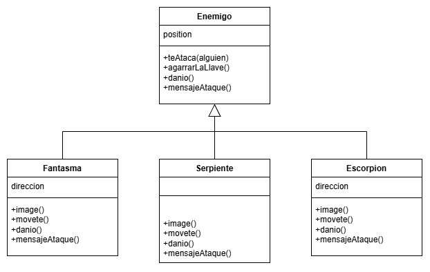
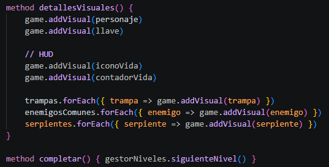
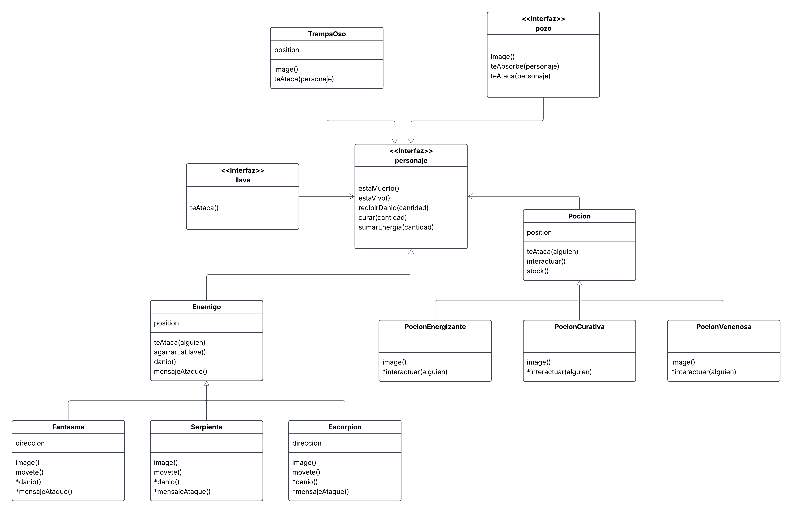

# Explicaciones teóricas

Polimorfismo + Herencia 

Para el modelado de los enemigos, se creó una clase abstracta Enemigo que contiene el comportamiento común entre ellos. Esto permite tratarlos de forma polimórfica, mientras que cada uno responde de manera diferente a los métodos compartidos.

Además, se implementó herencia para especializar las clases Fantasma, Serpiente y Escorpión, las cuales heredan las características generales de un enemigo y sobrescriben (override) aquellos métodos cuyo comportamiento es particular para cada tipo. De esta forma, se reutiliza el código común, se evita la duplicación de lógica y se facilita la incorporación de nuevos enemigos en el futuro.

 

Tambien Para modelar las pociones se utilizó herencia mediante una clase base Pocion, que define el comportamiento común a todas ellas, como la interacción con el personaje y la eliminación de la poción una vez utilizada. A partir de esta clase se especializaron PocionCurativa y PocionVenenosa, las cuales sobrescriben el método interactuar() para generar efectos distintos. Esto permitio reutilizar código común y tratar a todas las pociones de forma polimórfica, independientemente de su efecto particular.

El polimorfismo se aplicó en la parte de colisiones, donde se envía el mensaje teAtaca() y cada elemento responde de manera diferente.
- enemigos --> reducen la vida de Lionel
- trampas -->  se aplican distintos efectos según el tipo de trampa
- pociones --> benefician o perjudican a Lionel

Uso de colecciones 

Se utilizaron colecciones para almacenar grupos de enemigos y trampas de cada nivel. Estas colecciones son recorridas mediante forEach para ejecutar acciones sobre todos sus elementos, como agregarlos al juego (game.addVisual) o moverlos (enemigo.movete()), evitando la duplicación de código y facilitando la incorporación de nuevos objetos.

Otro ejemplo de su uso se encuentra en el objeto movimientoRandom, utilizado por la serpiente. Allí se define una colección con las posibles direcciones de movimiento y, mediante el mensaje anyOne(), se selecciona una de ellas de forma aleatoria para determinar el próximo desplazamiento del enemigo.

# Diagramas

